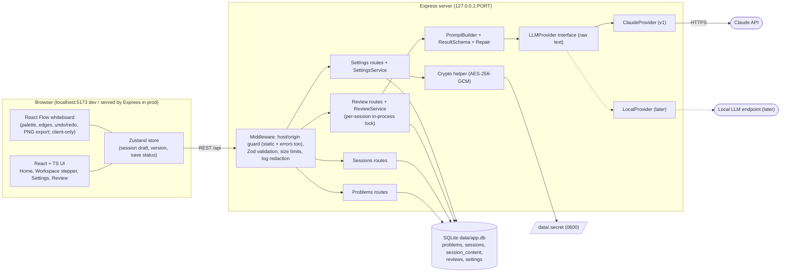

# SysDesign Studio: High-Level Design

Source: `docs/requirements.md` (UX reference: `docs/design.md`). Revised after architect review; see "Revision notes" at the end.

## 1. Requirements Recap

### Functional requirements
1. Users should be able to browse and filter problems by difficulty and start a session.
2. Users should be able to capture free-form requirements.
3. Users should be able to manage lists of functional and non-functional requirements (NFRs may carry a target).
4. Users should be able to define core entities (name, description, fields).
5. Users should be able to define API endpoints (method, path, request/response sketch, description).
6. Users should be able to draw the HLD on a whiteboard: drag components from a palette, connect and label edges, add notes to nodes, undo/redo, export PNG.
7. Users should be able to rely on autosave and resume sessions later.
8. Users should be able to submit a session for AI review and view scores, strengths, gaps and suggested improvements.
9. Users should be able to see a history of reviews per session (including failed attempts).
10. Users should be able to configure the AI provider and key in a Settings UI and test the connection.

### Non-functional requirements
| Area | Target |
|---|---|
| Deployment | Single-user, runs entirely on the user's machine; data stays local (only the review call leaves the machine, to the chosen provider). |
| Scale | One user, tens of problems, hundreds of sessions, a few thousand reviews at most. No horizontal scaling needed. |
| Security | API key never in browser storage; never returned in full by any API (masked hint only); server binds to 127.0.0.1 and rejects foreign Origin/Host; secrets redacted from logs; no cookie auth. |
| Extensibility | Provider-neutral review pipeline; the review pipeline UI needs no change when a local LLM is added (Settings gains a `base_url` form at that time). |
| Reliability of AI output | Review responses validated against a schema; one repair retry on malformed output. |
| Durability | Autosave must not lose more than a few seconds of edits; SQLite is the source of truth. WAL with `synchronous=NORMAL` can lose the last few committed transactions on an OS crash or power loss (not on app crash); accepted for v1. |
| Latency | Autosave server write under 100 ms (local; network round trip is loopback). Review is bounded by the LLM (target: under 60 s, with progress indicator). |
| Dev experience | One command starts client and server in development. |
| Consistency / availability | Strong consistency (single process, single SQLite file); availability equals the app being running. |

Assumed (not stated): read:write ratio is irrelevant at this scale; writes are dominated by autosave.

## 2. Core Entities

- **Problem**: seeded prompt (title, prompt, difficulty, tags). Never deleted.
- **Session**: one attempt at a problem. `submitted` is derived: true iff the session has at least one review with status `ok`.
- **SessionContent**: the working document (requirements text, functional list, NFR list, entities, APIs, diagram nodes/edges). Owns the single `version` counter.
- **Review**: record of one AI review attempt (status pending, ok or failed) with the snapshot of content and problem prompt it reviewed. Immutable once it leaves `pending`.
- **Settings**: provider, model, encrypted key (single row).
- Value types inside SessionContent: FunctionalRequirement, NonFunctionalRequirement, EntityDef, ApiEndpoint, DiagramNode, DiagramEdge.

## 3. API Design

REST, JSON, base path `/api`. No user in paths because there is a single local user and no accounts. All payloads validated by shared Zod schemas. Plural resource names throughout (`/reviews`).

| Method and path | Purpose | Failure codes (see 3.1) |
|---|---|---|
| `GET /api/health` | Liveness: `{ok: true, version}` | none |
| `GET /api/problems?difficulty=` | List problems, optional difficulty filter | validation_error |
| `GET /api/problems/:id` | Problem detail | not_found |
| `POST /api/sessions` `{problemId, title?}` | Create session (empty content, version 1) | validation_error, not_found |
| `GET /api/sessions?problemId=` | List sessions, default order `updated_at` desc. Summary: id, problem (id, title), title, `submitted` (bool), updated_at, `latestReview` (`{id, status, overallScore, verdict, createdAt}` or null; latest by created_at) | validation_error |
| `GET /api/sessions/:id` | Session metadata plus `content` and `version` (the one version field, from `session_content`) | not_found |
| `PUT /api/sessions/:id/content` `{content, baseVersion}` | Autosave full content; optimistic check. 200 `{version, updatedAt}` | version_conflict, validation_error, content_too_large, not_found |
| `PATCH /api/sessions/:id` `{title?}` | Rename | validation_error, not_found |
| `DELETE /api/sessions/:id` | Delete session and its reviews (409 `review_in_progress` if a review is pending) | not_found, review_in_progress |
| `POST /api/sessions/:id/reviews` `{baseVersion}` | Start a review. 202 `{reviewId, status: "pending"}` | version_conflict, review_in_progress, no_api_key, content_too_large, validation_error, not_found |
| `GET /api/sessions/:id/reviews` | Review history (summary list, includes failed and pending rows, newest first) | not_found |
| `GET /api/reviews/:id` | Full review: status pending/ok/failed; `result` when ok; `error {code, message}` when failed | not_found, validation_error |
| `GET /api/settings` | Provider, model, `keyHint` (e.g. `sk-...a1b2`), `keySource` (saved, env or none) | none |
| `PUT /api/settings` `{provider, model, apiKey?}` | Save settings; key write-only; omitting `apiKey` keeps the existing saved key | validation_error |
| `DELETE /api/settings/key` | Remove saved key only; never touches an env-var key | none |
| `POST /api/settings/test` `{provider?, model?, apiKey?}` | Test connection. Body optional; any supplied unsaved values override stored ones for this call only and are not persisted | no_api_key, provider_auth_failed, rate_limited, provider_unavailable, timeout, validation_error |

Notes:
- Autosave sends the whole content blob (small, typically under 100 KB) rather than field-level patches; simpler and sufficient.
- `GET /reviews/:id`: 404 `not_found` if the id does not exist; 400 `validation_error` if the id is malformed. Review POST is asynchronous (see 5.2) so a reload can resume by polling.
- Streaming is deferred; the provider interface permits it (see Deep Dives).

### 3.1 Error format and codes

Error body: `{ "error": { "code": string, "message": string, "details"?: any } }`. One table is the source of truth; `retryable` tells the client whether an automatic or user "retry" is sensible without changing input.

| code | HTTP | retryable | Notes |
|---|---|---|---|
| validation_error | 400 | no | Zod failure; `details` lists issues |
| no_api_key | 400 | no | No saved or env key |
| not_found | 404 | no | |
| version_conflict | 409 | no (needs user choice) | `details: {currentVersion}` |
| review_in_progress | 409 | yes (after it finishes) | |
| content_too_large | 413 | no | `details: {limitBytes, actualBytes}` |
| provider_auth_failed | 422 | no | Provider rejected key; deliberately not 401 so the browser/client never treats it as an app-auth failure |
| rate_limited | 429 | yes (with delay) | |
| provider_unavailable | 502 | yes | |
| review_malformed | 502 | yes | Output invalid after one repair |
| timeout | 504 | yes | |
| internal_error | 500 | no | Unexpected |

Provider-derived codes (`provider_auth_failed`, `rate_limited`, `provider_unavailable`, `review_malformed`, `timeout`) appear as HTTP statuses on `settings/test`, and as the stored `error_code` on a failed review row (the `POST /reviews` itself returns 202; the failure is observed through `GET /reviews/:id`, whose `error.code` uses this table). An additional stored code `interrupted` (no HTTP status; retryable yes) marks reviews cut off by a server restart.

## 4. High-Level Design



### Datastore schema (key fields)
- `problems(id PK, title, prompt, difficulty enum easy|medium|hard, tags JSON)`; seeded on first run, idempotent upsert by id. Seeded problems are never deleted (no delete endpoint; seed removal is a no-op).
- `sessions(id PK, problem_id FK REFERENCES problems ON DELETE RESTRICT, title, created_at, updated_at)`. No `status` and no `version` column: `submitted` is derived from reviews; `version` lives only in `session_content`.
- `session_content(session_id PK/FK ON DELETE CASCADE, content_json, version INT, updated_at)` where content_json = `{schemaVersion, requirements, functional[], nonFunctional[{text,target?}], entities[{name,description,fields[]}], apis[{method,path,request,response,description}], diagram{nodes[{id,type,label,note,position}], edges[{id,source,target,label,direction}]}}`. `updated_at` on the session is bumped in the same transaction as each content write.
- `reviews(id PK, session_id FK ON DELETE CASCADE, status pending|ok|failed, snapshot_json, result_json NULL, raw_output NULL, error_code NULL, error_message NULL, provider, model, prompt_version, duration_ms NULL, input_tokens NULL, output_tokens NULL, created_at, finished_at NULL)`. `snapshot_json` includes the reviewed content and the problem prompt text (title, prompt, difficulty) so history is immune to later changes. Index on `(session_id, created_at)`.
- `settings(id=1, provider, model, key_ciphertext, key_iv, key_tag, key_hint)`.

### Walkthroughs

**Browse and start.** Home calls `GET /problems?difficulty=`; Start calls `POST /sessions`, which inserts a session and an empty content row (version 1), then the UI routes to the workspace.

**Edit and autosave.** Edits update the Zustand store immediately. A debounced saver (about 1 s after the last change, plus on step change and page hide) sends `PUT /sessions/:id/content` with `baseVersion`. Server validates with Zod, checks the size cap, and in one transaction compares `baseVersion` to `session_content.version`, writes the blob, increments the version, and bumps `sessions.updated_at`; it responds `{version, updatedAt}` and the client stores the new version as the next `baseVersion`. On mismatch it returns 409 `version_conflict` with `details.currentVersion`. UI shows "Saving / Saved / Error (retrying) / Conflict". Resume loads `GET /sessions/:id`, which returns content and `version`.

**Whiteboard.** React Flow holds nodes and edges in the store; the palette adds typed nodes; the inspector edits label/note. Undo/redo is diagram-only (not text fields) and entirely client-side, in memory. PNG export is rendered entirely client-side. Diagram is part of the same content blob.

**Submit for review.**
1. UI forces a save and waits. If the save fails or returns 409, submit is blocked: the Submit button is disabled with the reason shown (UI never submits on unsaved or conflicting state).
2. UI calls `POST /sessions/:id/reviews {baseVersion}`. Server checks the per-session lock (409 `review_in_progress` if held), checks `baseVersion` equals stored version (409 `version_conflict` otherwise), checks key present (`no_api_key`) and size cap (`content_too_large`).
3. Server builds the snapshot, inserts a `pending` review row, takes the lock, responds 202 `{reviewId}`, and runs the pipeline in the background: build prompt, call provider, validate (one repair), then update the row to `ok` (with `result_json`, tokens, duration) or `failed` (with `error_code`, `raw_output` if any), and release the lock.
4. UI stores `reviewId` in the route (`/sessions/:id/review/:reviewId`) and polls `GET /reviews/:id` (about every 1.5 s) until status is not pending. Reload therefore resumes the progress view. On `failed`, UI shows the error and a "Retry review" button, which posts a new review (new row). History lists all rows including failed ones.

**Settings.** `PUT /settings` encrypts a supplied key with AES-256-GCM using the key in `data/.secret` and stores ciphertext plus a masked hint; with no `apiKey` in the body the existing key is kept. `GET` returns only provider, model, hint, source. `POST /settings/test` builds a provider from the body values (falling back to stored ones, then env) and calls `provider.testConnection()`, so users can test before saving. "Remove key" deletes only the saved key; if `ANTHROPIC_API_KEY` is set it remains in use and `keySource` becomes `env`. Default model is `claude-sonnet-5-5`; an invalid model name is not validated against a list but is caught by the connection test (and surfaces as `provider_unavailable`/`validation_error` details from the provider).

### Areas needing deeper treatment
Autosave concurrency and failure, review pipeline robustness (pending state, schema, prompt), key/localhost security, local-LLM extensibility (all in Deep Dives).

## 5. Deep Dives

### 5.1 Autosave integrity (durability, multi-tab)
- Problem: debounce races, offline server, and two tabs editing the same session.
- Resolution: a single in-flight save per session with a trailing save queued (coalesced); each save carries `baseVersion`, checked against the single `session_content.version`. Server returns `409 version_conflict` with `details.currentVersion` if stale.
- Conflict handling (v1: last-writer-wins by explicit user choice). The conflicted tab stops autosaving (state "Conflict", edits stay in the store) until the user chooses:
  - "Download my draft": offers the tab's local draft as a JSON download (offered before Overwrite is confirmed).
  - "Overwrite": resends the same content with `baseVersion = currentVersion` from the 409 body; if that conflicts again the banner repeats.
  - "Reload latest": discards the local draft and loads `GET /sessions/:id`.
- Submit is blocked while in Conflict or Error save state (5.2).
- Failed saves (network/5xx) retry with exponential backoff (1 s up to 30 s) and a `beforeunload` guard while dirty. 4xx other than 409 (validation, `content_too_large`) do not retry and surface a persistent error.
- SQLite in WAL mode with synchronous=NORMAL; writes are transactional. Trade-off: an OS crash or power loss can lose the last few committed transactions (app crashes cannot); acceptable given the few-seconds durability target and the autosave cadence.
- Whole-blob writes are acceptable: content is small, and this avoids merge logic.

### 5.2 Review pipeline robustness

**Provider interface (intentionally differs from `requirements.md`).** The requirements sketch has providers returning validated results. Here providers return raw text and validation lives above them, so the repair path is provider-independent:
- `review(req: {messages: Message[], jsonSchema?: object, signal: AbortSignal}) -> {text, usage?: {inputTokens, outputTokens}}`
- `testConnection({signal}) -> void` (throws a categorised error).
- `messages` is a message history, so the repair call is the same method with history `[original prompt, invalid assistant output, repair instruction with validation errors]`. `jsonSchema` is an optional hint (e.g. Claude structured output); providers may ignore it.
- `AbortSignal` carries the timeout (90 s, tunable) and is the cancellation hook.

**Pending state, lock, disconnect and restart.**
- The `pending` row is written before the provider call and is the durable record of an in-flight review. An in-process per-session lock (a Set of session ids) rejects a concurrent review with 409 `review_in_progress`; it is released in a `finally`. Single process makes this sufficient; the pending row also lets the check survive as a data fact on reload.
- Client disconnect (tab closed, reload, navigation): the pipeline is decoupled from the HTTP request, so the provider call finishes and the result is stored. The user sees it on return via history or the resumed polling view.
- Server restart: on startup, any `pending` rows are marked `failed` with `error_code = interrupted` (and `finished_at` set); the lock set starts empty. The user can retry.
- `submitted` rule: a session counts as submitted iff it has at least one `ok` review. Failed or pending reviews never mark it submitted. Editing remains allowed after review; a new review can be run any time.

**Review output schema (v1).** Follow-up questions and the reference outline are dropped from v1 (matches the three cards in the mock-up). Zod-level sketch:

```
Verdict   = enum("strong_no_hire","no_hire","lean_hire","hire","strong_hire")
Section   = enum("requirements","entities","api","high_level_design","non_functional")  // matches the 5 score bars in the mock-up
Score     = number, min 1, max 5, multiple of 0.5            // per-section
Priority  = enum("high","medium","low")
Item      = { title: string(1..120), detail: string(1..600), section: Section, priority: Priority }

ReviewResult = {
  overallScore: number, min 1, max 5, one decimal,
  verdict: Verdict,
  summary: string(1..800),
  sections: array(max 5) of { section: Section, score: Score, comment: string(1..800) },
  strengths: array(max 8) of Item,
  gapsAndRisks: array(max 10) of Item,
  improvements: array(max 8) of Item      // ordered by priority; priority field is authoritative
}
```
The UI maps `strengths`, `gapsAndRisks`, `improvements` to the three cards. The `jsonSchema` hint is derived from this Zod schema. Out-of-range values fail validation (no clamping) and go through the repair call. Prompt and schema carry `prompt_version`, stored on each review.

**Validation and repair.** Parse JSON (strip code fences), validate with Zod. On failure, one repair call with the history above. If it still fails, the row is `failed` with `error_code = review_malformed` and `raw_output` kept for debugging.

**Claude path.** Use structured output/tool-use with the derived JSON schema where available; validation and repair remain the provider-independent safety net, which matters most for small local models.

**Prompt construction.**
- Fixed system rubric and section instructions, then user material inside delimited, tagged blocks (`<problem>`, `<requirements>`, `<entities>`, `<apis>`, `<diagram>`, `<notes>`). The prompt instructs the model to treat everything inside tags as data to evaluate, never as instructions; the delimiter strings are stripped or escaped from user content so it cannot close a block.
- Diagram format (stable ids so the model and hints refer to the same thing):
  ```
  n1 [service "Shorten Service"] note: "stateless"
  n2 [database "URL Store"]
  n3 [other "Analytics Pipeline"]
  n1 -> n2 "write"
  n2 <-> n3 "replicate"      // direction from the edge's direction field: forward | both | none
  ```
  Node types: client, load_balancer, api_gateway, service, database, cache, message_queue, object_store, cdn, and `other` (free-form fallback, label carries meaning). Edge `direction` is `forward` (default), `both` or `none` (rendered `->`, `<->`, `--`).
- Computed hints appended in a `<hints>` block: isolated nodes (no edges), no datastore present, no path from any client node to a datastore. Hints are facts, not verdicts.
- Positions are excluded. The prompt states that the AI sees only the graph, not the layout or visual arrangement, and must not judge layout or aesthetics.
- Empty or trivial designs are allowed; the prompt tells the model to score missing sections low rather than invent content.

**Limits and failures.**
- Oversized content: reject, never silently truncate. `PUT content` and `POST reviews` return 413 `content_too_large` with `{limitBytes, actualBytes}`. Limit is a tunable placeholder, v1 default `MAX_CONTENT_BYTES = 256 KB` of serialized content (config constant, to be tuned against real prompt token budgets). The UI shows the limit and current size once above about 80%.
- Mapped errors per the single table in 3.1; provider errors are categorised inside the provider adapter.
- Streaming: not in v1 UI (spinner with step text driven by polling). Adding `AsyncIterable` later is additive via SSE on the same review resource.
- Prompt quality is iterated using good and deliberately flawed sample designs kept as fixtures.

### 5.3 Key handling and localhost security
- Key stored AES-256-GCM encrypted (random IV per write, auth tag stored); encryption key generated on first run into `data/.secret` with mode 0600; refuse to start if its permissions are looser (or tighten them). Explicit limit: protects against casual disclosure, not an attacker with full account access.
- The browser only ever sends the key on `PUT /settings` (or the optional unsaved `POST /settings/test` body) and never reads it back; the client clears the field after saving. API responses and logs never contain it: a logger redaction layer masks the `apiKey` field, `Authorization`, and `x-api-key` headers; tests assert this.
- Server binds to `127.0.0.1` only, on a configured port (`PORT`, default 3001). The Host/Origin allowlist is derived from that configured port: allowed Hosts are `localhost:PORT` and `127.0.0.1:PORT`; allowed Origins are `http://localhost:PORT`, `http://127.0.0.1:PORT`, plus in dev only the Vite origin (`http://localhost:5173`, port configurable). The server fails fast at startup if the port is already in use (never silently falls back to another port, which would invalidate the allowlist and could let another local process answer).
- Host validation defeats DNS rebinding. Origin is checked on all non-GET requests and on GETs carrying an Origin header. The guard runs ahead of everything, including the static client files and error responses (404, 500, validation errors), so a rejected request never leaks content. JSON content type is required on mutating routes (blocks simple cross-site form posts). No CORS wildcard.
- No cookie auth and no sessions cookies: there is no ambient credential for a cross-site request to ride on, which is why Origin/Host checks are sufficient for the single-user model.
- Optional later: OS keychain with encrypted-file fallback; the `SettingsService` hides storage behind a `SecretStore` interface so this swaps without route changes.
- Key resolution order: saved key, else `ANTHROPIC_API_KEY`. "Remove key" only deletes the saved key.

### 5.4 Local LLM extensibility
- `LLMProvider` registry keyed by `id`. `LocalProvider` will target any OpenAI-compatible endpoint (base URL, model, optional key). Settings uses two hardcoded forms (Claude: model and key; Local: base URL, model, optional key), selected by provider; the earlier server-driven field descriptor is dropped as over-engineering for two providers. The review pipeline UI needs no change; Settings gains a `base_url` form when Local lands (settings table gains `base_url` via migration). Model discovery via `/v1/models`.
- Because small models produce unreliable JSON, the validation and repair path (5.2) is already in the core and not in the Claude provider.

### 5.5 Whiteboard to AI: structured diagram
- Store node types (client, load_balancer, api_gateway, service, database, cache, message_queue, object_store, cdn, other), label, note; edges with label and `direction`. The prompt receives the stable-id node list and edge list described in 5.2, not an image, so the review is deterministic and cheap. Positions are excluded from the snapshot.
- Hints (isolated nodes, missing datastore, no client-to-datastore path) are computed locally. The AI cannot judge layout and is told so.
- Undo/redo covers the diagram only (not text forms), is client-only, capped (e.g. 100 steps) and not persisted. PNG export is client-side.

### 5.6 Data evolution and portability
- Content is a versioned JSON blob (`schemaVersion` inside `content_json`) with Zod migrations on read; migrated content is lazily written back on the next normal save (no bulk rewrite), so form changes do not need table migrations. SQL schema managed by simple numbered migration files run at startup. Reviews keep their own snapshot (content and problem prompt) so later edits never change history. Backup equals copying `data/` (with the app stopped, or including the WAL files).

### 5.7 Run and deploy shape
- Monorepo with `client`, `server`, `shared` (Zod schemas and types). Dev: one command (e.g. a root script running Vite and the server concurrently, Vite proxying `/api`). Prod/local use: Express serves the built client from the same origin, which also simplifies origin checks. `GET /api/health` supports the dev runner and smoke tests.

## 6. Open Questions / Assumptions

- Assumed: encrypted file (not OS keychain) for v1, per the requirements doc.
- Assumed: single local user, no auth on the API beyond localhost binding and origin/host checks; no cookies.
- Assumed: non-streaming provider call in v1 (async job plus polling for the review); streaming is a later additive change.
- Assumed: whole-blob autosave with optimistic versioning is sufficient; no real-time collaboration.
- Decided: review timeout 90 s and `MAX_CONTENT_BYTES` 256 KB are tunable placeholders; exact values to be tuned.
- Decided: submitted sessions remain editable; `submitted` means at least one `ok` review; a new review can be run any time.
- Decided: submit is blocked on save failure or conflict; `baseVersion` mismatch returns 409.
- Decided: oversized content is rejected with 413, never truncated.
- Decided: follow-up questions and reference outline are out of v1 review output.
- Decided: autosave 409 uses explicit last-writer-wins Overwrite with draft download first.
- Open: whether to allow deleting individual reviews (assumed only via deleting the session).
- Open: whether to revisit follow-up questions and reference outline post-v1.
- Open: final product name check on GitHub, npm and domain registrar (from the requirements doc).
- Not designed in mock-ups: Functional/NFR lists, entities, API forms, sessions history, error, conflict and empty states; to be covered at LLD or UX stage.

## 7. Revision notes

Changes from the architect review (finding numbers in parentheses):
- (1) Submit takes `{baseVersion}`; 409 on mismatch; UI blocks submit on save failure or conflict.
- (2) 409 on autosave: conflicted tab pauses autosave; Download draft, Overwrite (resend against `currentVersion`) or Reload latest.
- (3) Single `version` in `session_content`; removed `sessions.version`; `GET /sessions/:id` returns it; PUT content returns `{version, updatedAt}`; 409 body includes `currentVersion`.
- (4) `pending` review row, polling `GET /reviews/:id`, in-process per-session lock, disconnect lets the call finish, restart marks stale pending rows `failed/interrupted`.
- (5) Single error table with HTTP status and retryable; failure codes added to the API table; provider auth failure is 422, not 401.
- (6) Host/Origin allowlist derived from configured port, fail fast on port clash, applied to static files and error responses, explicitly no cookie auth.
- (7) Review output schema sketch with ranges, array maxima and item shape.
- (8) Diagram prompt format with stable ids, edge direction, `other` type, computed hints, no layout judgement.
- (9) User content in tagged blocks treated as data.
- (10) 413 `content_too_large` with tunable limit placeholder; no truncation.
- (11) ON DELETE RESTRICT for problems, seeds never deleted, problem prompt snapshotted into reviews.
- (12) `GET /sessions` supports `?problemId=`, orders by `updated_at` desc, includes latest review.
- (13) Settings: unsaved test body, key kept when `apiKey` omitted, Remove key never touches env key, default model `claude-sonnet-5-5`, bad model caught by test.
- (14) Provider interface deviates from requirements.md on purpose; AbortSignal, message-history repair call, optional `jsonSchema`.
- (15) Reviews table extended (raw_output, error_code, duration, tokens, prompt_version, status); failed rows show in history.
- (16) `submitted` derived from at least one `ok` review; editing allowed.
- Low items: `schemaVersion` in content_json; undo/redo diagram-only and client-only; PNG export client-side; autosave latency reworded; WAL/NORMAL loss trade-off and lazy write-back for migrations stated; server-driven settings descriptor dropped (two hardcoded forms, `SecretStore` kept); "no UI changes" wording aligned; `GET /api/health` added; 404/400 on `GET /reviews/:id`; `/reviews` kept plural.

v1 decisions recorded: block submit on save problems; durable pending reviews with polling; submitted = at least one ok review; reject oversized content (256 KB placeholder); no follow-ups or outline in output; verdict enum strong_no_hire..strong_hire with half-point section scores 1-5; unsaved-values test connection; last-writer-wins overwrite on autosave conflict with draft download.
