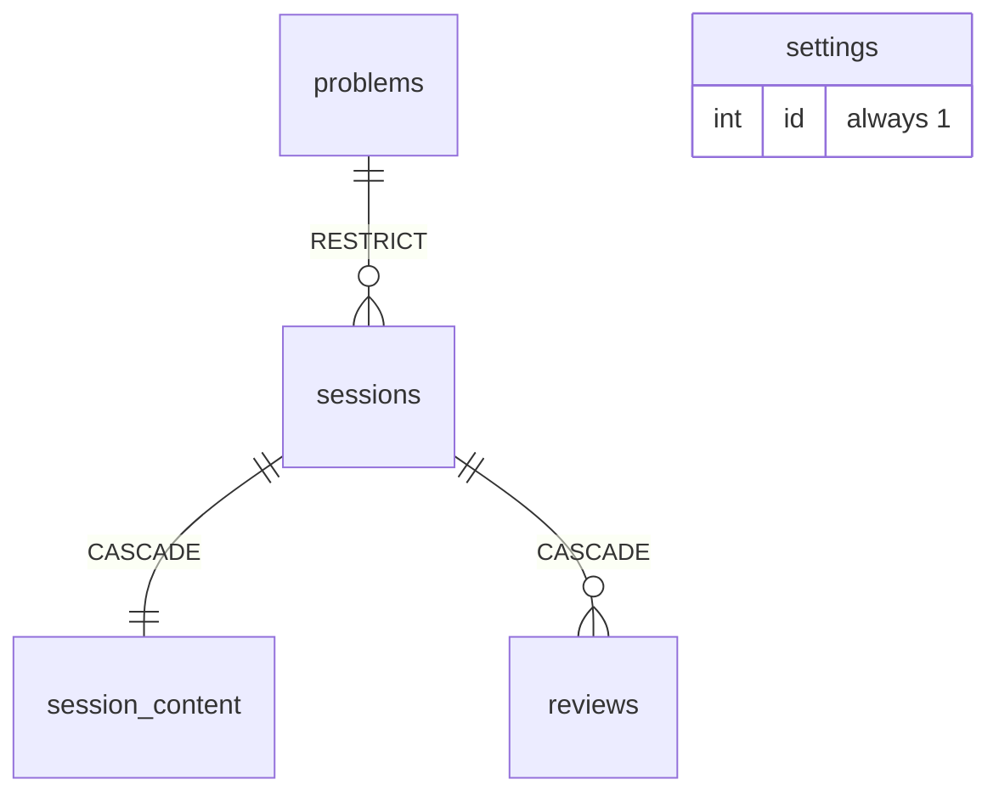
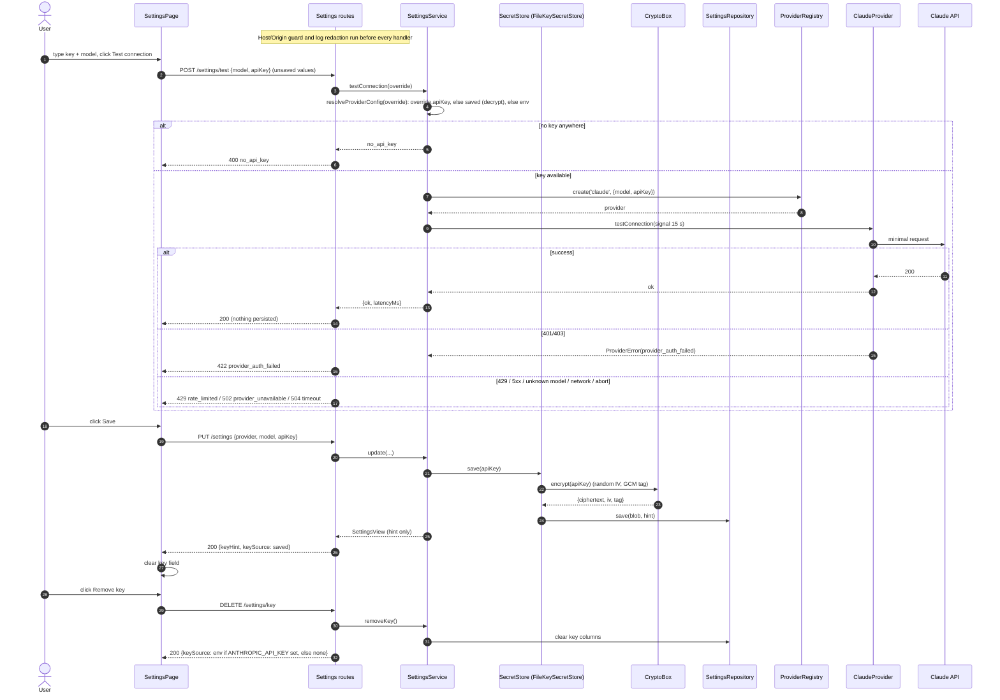
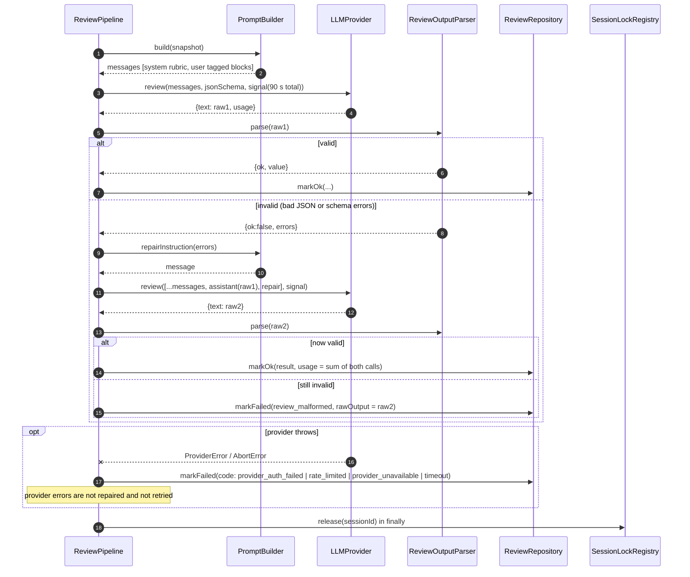

# SysDesign Studio: Low-Level Design

Source: `docs/requirements-hld.md` (HLD, authoritative for decisions), `docs/requirements.md`, `docs/design.md` (UI reference). This document makes the HLD implementation-ready. It introduces no new architecture; where the HLD left a detail open, the choice made here is listed in section 7 (Assumptions).

Repository layout (monorepo, per HLD 5.7): `shared/` (Zod schemas, types, constants), `server/` (sds-backend), `client/` (sds-front-end), `data/` (runtime: `app.db`, `.secret`).

---

## 1. Data Models

### 1.1 Conventions
- IDs: `TEXT` primary keys. Problems use stable slug ids (`url-shortener`). Sessions and reviews use UUID v4 generated by the server.
- Timestamps: `TEXT` ISO-8601 UTC with milliseconds (`2026-10-16T09:30:00.123Z`), generated by the server. Lexicographic order equals chronological order.
- JSON columns are `TEXT` with `CHECK (json_valid(col))`.
- Connection pragmas on open: `journal_mode=WAL`, `synchronous=NORMAL`, `foreign_keys=ON`, `busy_timeout=5000`.
- Migrations: numbered files `server/src/db/migrations/NNN_name.sql`, applied in order at startup inside a transaction each, tracked in `schema_migrations`.

### 1.2 SQL schema (migration 001_init)

```
schema_migrations
  version      INTEGER PRIMARY KEY
  name         TEXT    NOT NULL
  applied_at   TEXT    NOT NULL

problems
  id           TEXT PRIMARY KEY                      -- slug, e.g. 'url-shortener'
  title        TEXT NOT NULL CHECK (length(title) BETWEEN 1 AND 120)
  prompt       TEXT NOT NULL CHECK (length(prompt) BETWEEN 1 AND 4000)
  difficulty   TEXT NOT NULL CHECK (difficulty IN ('easy','medium','hard'))
  tags         TEXT NOT NULL DEFAULT '[]' CHECK (json_valid(tags))   -- JSON array of strings
  sort_order   INTEGER NOT NULL DEFAULT 0            -- stable display order for seeds
INDEX idx_problems_difficulty ON problems(difficulty, sort_order)

sessions
  id           TEXT PRIMARY KEY
  problem_id   TEXT NOT NULL REFERENCES problems(id) ON DELETE RESTRICT
  title        TEXT NOT NULL CHECK (length(title) BETWEEN 1 AND 120)
  created_at   TEXT NOT NULL
  updated_at   TEXT NOT NULL
INDEX idx_sessions_updated ON sessions(updated_at DESC)
INDEX idx_sessions_problem ON sessions(problem_id, updated_at DESC)

session_content
  session_id   TEXT PRIMARY KEY REFERENCES sessions(id) ON DELETE CASCADE
  content_json TEXT NOT NULL CHECK (json_valid(content_json))
  version      INTEGER NOT NULL CHECK (version >= 1)
  updated_at   TEXT NOT NULL

reviews
  id             TEXT PRIMARY KEY
  session_id     TEXT NOT NULL REFERENCES sessions(id) ON DELETE CASCADE
  status         TEXT NOT NULL CHECK (status IN ('pending','ok','failed'))
  snapshot_json  TEXT NOT NULL CHECK (json_valid(snapshot_json))
  result_json    TEXT NULL CHECK (result_json IS NULL OR json_valid(result_json))
  raw_output     TEXT NULL
  error_code     TEXT NULL
  error_message  TEXT NULL
  provider       TEXT NOT NULL
  model          TEXT NOT NULL
  prompt_version TEXT NOT NULL
  content_version INTEGER NOT NULL                    -- session_content.version reviewed
  duration_ms    INTEGER NULL
  input_tokens   INTEGER NULL
  output_tokens  INTEGER NULL
  created_at     TEXT NOT NULL
  finished_at    TEXT NULL
  CHECK ((status='ok')      = (result_json IS NOT NULL))
  CHECK ((status='failed')  = (error_code  IS NOT NULL))
  CHECK ((status='pending') = (finished_at IS NULL))
INDEX idx_reviews_session_created ON reviews(session_id, created_at DESC)
UNIQUE INDEX uq_reviews_one_pending ON reviews(session_id) WHERE status='pending'
INDEX idx_reviews_session_ok ON reviews(session_id) WHERE status='ok'

settings
  id             INTEGER PRIMARY KEY CHECK (id = 1)
  provider       TEXT NOT NULL CHECK (provider IN ('claude'))   -- 'local' added by a later migration
  model          TEXT NOT NULL CHECK (length(model) BETWEEN 1 AND 100)
  key_ciphertext BLOB NULL
  key_iv         BLOB NULL
  key_tag        BLOB NULL
  key_hint       TEXT NULL
  updated_at     TEXT NOT NULL
  CHECK ((key_ciphertext IS NULL) = (key_iv IS NULL) AND (key_iv IS NULL) = (key_tag IS NULL) AND (key_tag IS NULL) = (key_hint IS NULL))
```

Notes on constraints:
- `uq_reviews_one_pending` is defense in depth behind the in-process lock: two pending rows for one session are impossible at the data level.
- The three `CHECK`s on `reviews` encode the state machine: `ok` rows always have a result; `failed` rows always have an error code; only `pending` rows lack `finished_at`.
- `settings` row is inserted by migration/bootstrap with defaults (`provider='claude'`, `model='claude-sonnet-5-5'`, no key).
- `submitted` is never stored. It is computed as `EXISTS (SELECT 1 FROM reviews WHERE session_id = s.id AND status='ok')`.
- Deleting a session cascades to `session_content` and `reviews`. Problems are protected by `ON DELETE RESTRICT`.

### 1.3 Seed data
`server/src/db/seeds/problems.ts` holds the six seeded problems (URL Shortener easy, Design Twitter medium, Ride Sharing hard, Chat Application medium, Rate Limiter easy, Video Streaming hard) with `sort_order` 1..6. `ProblemSeeder.run()` executes at every startup: `INSERT ... ON CONFLICT(id) DO UPDATE SET title, prompt, difficulty, tags, sort_order`. It never deletes.

### 1.4 Content document (`content_json`), shared Zod schema `SessionContentSchema`

```
SessionContent {
  schemaVersion: 1                                      // literal, migrated on read
  requirements: string (max 20000)
  functional:    FunctionalRequirement[]  (max 100)
  nonFunctional: NonFunctionalRequirement[] (max 100)
  entities:      EntityDef[]             (max 50)
  apis:          ApiEndpoint[]           (max 100)
  diagram: { nodes: DiagramNode[] (max 200), edges: DiagramEdge[] (max 400) }
}
FunctionalRequirement    { id: string(1..40), text: string(0..500) }
NonFunctionalRequirement { id: string(1..40), text: string(0..500), target?: string(0..120) }
EntityDef   { id: string(1..40), name: string(0..80), description: string(0..1000),
              fields: { id: string(1..40), name: string(0..80), type: string(0..60), note?: string(0..300) }[] (max 50) }
ApiEndpoint { id: string(1..40), method: 'GET'|'POST'|'PUT'|'PATCH'|'DELETE', path: string(0..200),
              request: string(0..2000), response: string(0..2000), description: string(0..1000) }
NodeType    = 'client'|'load_balancer'|'api_gateway'|'service'|'database'|'cache'|'message_queue'|'object_store'|'cdn'|'other'
DiagramNode { id: string(1..40), type: NodeType, label: string(0..80), note: string(0..500), position: {x: number, y: number} }
DiagramEdge { id: string(1..40), source: nodeId, target: nodeId, label: string(0..80), direction: 'forward'|'both'|'none' (default 'forward') }
```

Validation rules beyond field shape (enforced by a `superRefine` on the schema):
- All `id`s unique within their own array.
- Edge `source`/`target` must reference existing node ids; self-loops allowed.
- Text fields may be empty (drafts are allowed mid-edit); emptiness is judged by the reviewer, not the saver.
- Size cap is applied to the serialized JSON separately (`MAX_CONTENT_BYTES`, section 3.7), not through Zod.

The empty content created with a session is `{schemaVersion:1, requirements:"", functional:[], nonFunctional:[], entities:[], apis:[], diagram:{nodes:[],edges:[]}}`, exported as `emptyContent()` from `shared`.

### 1.5 Review snapshot and result

```
ReviewSnapshot {
  problem: { id, title, prompt, difficulty }
  content: SessionContent          // positions retained in snapshot; stripped only when building the prompt
  contentVersion: number
}
```
Note: the HLD says positions are excluded from the snapshot. Decision: excluded. The snapshot stores `content` with `diagram.nodes[].position` removed (type `SnapshotNode = Omit<DiagramNode,'position'>`). The review page therefore never re-renders the layout from history, only the graph.

`ReviewResult` is exactly the schema in HLD 5.2 (`Verdict`, `Section`, `Score` in 0.5 steps 1..5, `Item`, array maxima 5/8/10/8), exported as `ReviewResultSchema` from `shared`. Additional refinements: `sections` must not repeat a `section` value; `overallScore` must have at most one decimal (`Math.round(x*10)===x*10` within epsilon).

### 1.6 Entity relationships



### 1.7 Row and DTO types
- `*Row` types (snake_case, mirror columns) live in `server/src/db/rows.ts`; mappers `toSessionSummary`, `toReviewSummary`, `toReviewDetail` convert rows to API DTOs (camelCase) defined in `shared/src/api.ts`. Rows never leave the repository layer.

---

## 2. Component / Class Design

### 2.1 sds-backend (`server/src`)

Layering: routes (HTTP only) -> services (business rules, transactions) -> repositories (SQL only) -> `Database`. Providers and crypto are injected into services through constructors. A single composition root (`app/container.ts`) wires everything; tests build the container with fakes.

```
server/src
  main.ts                      -- bootstrap: config, db, migrate, seed, recover, listen
  app/
    createApp.ts               -- builds Express app from container (no listen), used by tests
    container.ts               -- composition root
    config.ts                  -- Config: port, host=127.0.0.1, dataDir, maxContentBytes, reviewTimeoutMs, devOrigin
  http/
    middleware/
      hostOriginGuard.ts
      requireJson.ts
      validate.ts
      errorHandler.ts
      requestLogger.ts
    routes/
      healthRoutes.ts problemRoutes.ts sessionRoutes.ts reviewRoutes.ts settingsRoutes.ts
    staticClient.ts
  domain/
    errors.ts                  -- AppError + factories
    contentMigrations.ts
    diagramHints.ts
  services/
    ProblemService.ts SessionService.ts ReviewService.ts SettingsService.ts
  review/
    PromptBuilder.ts DiagramSerializer.ts ReviewOutputParser.ts ReviewPipeline.ts SessionLockRegistry.ts
  providers/
    LLMProvider.ts ProviderRegistry.ts ClaudeProvider.ts ProviderErrors.ts
  security/
    SecretStore.ts FileKeySecretStore.ts CryptoBox.ts KeyHint.ts logRedaction.ts
  db/
    Database.ts migrate.ts migrations/ seeds/ rows.ts
    repositories/ ProblemRepository.ts SessionRepository.ts ContentRepository.ts ReviewRepository.ts SettingsRepository.ts
```

#### 2.1.1 Errors (`domain/errors.ts`)
```
class AppError extends Error { code: ErrorCode; status: number; retryable: boolean; details?: unknown }
ErrorCode = validation_error | no_api_key | not_found | version_conflict | review_in_progress | content_too_large
          | provider_auth_failed | rate_limited | provider_unavailable | review_malformed | timeout | internal_error
          | interrupted        // stored-only, never an HTTP status
```
A single `ERROR_TABLE: Record<ErrorCode,{status,retryable}>` in `shared` mirrors HLD 3.1; `AppError` takes status/retryable from it so the table is the one source of truth, used by server and client (client uses `retryable`).

#### 2.1.2 Middleware
- `hostOriginGuard(allowed: {hosts:Set<string>, origins:Set<string>})`: first in the chain, mounted before static files, routes and the error handler. Rejects with 403 `{error:{code:'forbidden_origin'...}}`. This is the one code outside the HLD table: the HLD requires rejection but gave no code; it is added to the table (see 7). Rules: `Host` header must be in `hosts`; if `Origin` present (any method) or method is non-GET/HEAD, then `Origin` must be present-and-allowed for non-GET (a missing Origin on a non-GET is allowed only when `Sec-Fetch-Site` is absent or `same-origin`/`none`, to keep curl/tests working; otherwise reject). Allowed sets are computed once by `buildAllowlist(config)`.
- `requireJson`: for POST/PUT/PATCH with a body, `Content-Type` must be `application/json`; else 400 `validation_error`. Body limit: JSON parser limit is `MAX_CONTENT_BYTES + 64 KB` so oversize bodies reach the handler and produce 413 `content_too_large` with actual bytes instead of a generic parser error. A parser `entity.too.large` error is mapped to 413 `content_too_large` too.
- `validate({params?, query?, body?})`: runs Zod; failure becomes `validation_error` with `details: ZodIssue[]` (path, message). Parsed values replace `req.params/query/body`.
- `errorHandler`: maps `AppError` to the error body; unknown errors log (redacted) and return 500 `internal_error` with a generic message; unknown routes under `/api` return 404 `not_found`. Runs behind the guard so errors never leak across origins.
- `requestLogger`: structured log with method, path, status, ms; no bodies. Uses `logRedaction`.

#### 2.1.3 Repositories (SQL only, synchronous `better-sqlite3`)
```
ProblemRepository
  list(difficulty?: Difficulty): ProblemRow[]
  get(id): ProblemRow | undefined
  upsertMany(rows): void
SessionRepository
  insert(row): void
  get(id): SessionRow | undefined
  listSummaries(problemId?): SessionSummaryRow[]     // joins problems, EXISTS ok-review, latest review by created_at
  rename(id, title, now): boolean
  touch(id, now): void
  delete(id): boolean
ContentRepository
  insert(sessionId, contentJson, version, now): void
  get(sessionId): {contentJson, version, updatedAt} | undefined
  compareAndSwap(sessionId, baseVersion, contentJson, now): {version, updatedAt} | {conflict: currentVersion}
      // UPDATE ... SET version=version+1 WHERE session_id=? AND version=?; changes==0 -> read current version
ReviewRepository
  insertPending(row): void
  get(id): ReviewRow | undefined
  listBySession(sessionId): ReviewSummaryRow[]       // newest first, excludes snapshot/raw/result blobs
  markOk(id, {resultJson, rawOutput?, usage, durationMs, finishedAt}): void   // WHERE status='pending'
  markFailed(id, {errorCode, errorMessage, rawOutput?, durationMs?, finishedAt}): void  // WHERE status='pending'
  failAllPending(code, message, now): number
  hasPending(sessionId): boolean
SettingsRepository
  get(): SettingsRow
  save({provider, model, keyBlob?: {ciphertext, iv, tag, hint} | 'keep' | 'clear'}, now): void
```
`markOk`/`markFailed` update only rows still `pending`; zero changes means the row was already finalised (for example by restart recovery) and the pipeline logs and discards its result. This keeps `ok`/`failed` rows immutable.

#### 2.1.4 Services

**ProblemService**: `list(difficulty?)`, `get(id)` (throws `not_found`).

**SessionService**
```
create({problemId, title?}): SessionDetail     // tx: check problem (not_found), insert session + empty content v1
                                               // default title = "<problem title> attempt <n>" where n = count of existing sessions for that problem + 1
list(problemId?): SessionSummary[]
get(id): SessionDetail                         // runs contentMigrations.migrate(); does not write back
saveContent(id, content, baseVersion): {version, updatedAt}
     // 1 size check (before DB) 2 tx { CAS on version; on success bump sessions.updated_at } 3 throw version_conflict{currentVersion} or not_found
rename(id, title): SessionSummary
delete(id): void                                // not_found; review_in_progress if lock held OR hasPending
```
`saveContent` stores the migrated-forward shape (always writes `schemaVersion` current); this is the lazy write-back of HLD 5.6.

**ReviewService** (orchestration; the only owner of the lock)
```
start(sessionId, baseVersion): {reviewId, status:'pending'}
   order of checks: session exists (not_found) -> lock free (review_in_progress) -> baseVersion == stored version (version_conflict)
   -> resolve key via SettingsService.resolveProviderConfig() (no_api_key) -> serialized size <= max (content_too_large)
   -> tx: build snapshot, insertPending -> lock.acquire -> enqueue pipeline on setImmediate -> return
get(reviewId): ReviewDetail
listForSession(sessionId): ReviewSummary[]
recoverInterrupted(): number                   // called from main.ts before listen
```
The size check uses the same serialized-bytes function as `saveContent`. The lock is acquired inside the same synchronous block as the pending insert, so no await gap exists between check and acquire.

**ReviewPipeline** (one run of a review; pure orchestration, no HTTP)
```
run(reviewId, snapshot, providerConfig): Promise<void>
   1 messages = PromptBuilder.build(snapshot)
   2 AbortSignal.timeout(reviewTimeoutMs) shared across first call and repair call
   3 raw1 = provider.review({messages, jsonSchema, signal})
   4 parsed = ReviewOutputParser.parse(raw1.text)
   5 if invalid: raw2 = provider.review({messages: [...messages, assistant(raw1.text), user(repairInstruction(errors))], ...}); parse again
   6 ok -> repo.markOk;  invalid again -> markFailed(review_malformed, rawOutput = last raw text)
   catch ProviderError(code) -> markFailed(code); AbortError -> markFailed('timeout'); other -> markFailed('internal_error')
   finally lock.release(sessionId)
```
Token usage is summed across the first and repair calls. `duration_ms` is wall clock from pipeline start.

**SettingsService**
```
get(): SettingsView                              // {provider, model, keyHint|null, keySource: 'saved'|'env'|'none'}
update({provider, model, apiKey?}): SettingsView // apiKey undefined -> keep; non-empty -> encrypt+store; empty string is a validation_error
removeKey(): SettingsView                        // clears saved key only
resolveProviderConfig(override?): {provider, model, apiKey, source}   // order: override.apiKey, saved, env ANTHROPIC_API_KEY; else no_api_key
testConnection(override?): {ok:true, model}      // builds provider via ProviderRegistry; provider.testConnection({signal 15s})
```
The saved key decrypt happens only in `resolveProviderConfig`; the plaintext is held in local variables for the call and never cached on the instance.

#### 2.1.5 Review building blocks
- **SessionLockRegistry**: `tryAcquire(id): boolean`, `release(id)`, `isHeld(id)`. Backed by `Set<string>`.
- **PromptBuilder**: `build(snapshot): Message[]` and `repairInstruction(errors: string[]): Message`; constants `PROMPT_VERSION = "v1"`. Content assembly in `DiagramSerializer.serialize(nodes, edges)` (stable ids `n1..nN` assigned by array order; edge lines use `->`, `<->`, `--`) and `diagramHints.compute(nodes, edges)` (isolated nodes, no database node, no client-to-database path via directed reachability treating `both`/`none` as bidirectional). `sanitize(text)` strips or escapes the delimiter tags (`<problem>`, `</problem>`, etc., case-insensitive, including whitespace variants) from every user string.
- **ReviewOutputParser**: `parse(text): {ok:true, value: ReviewResult} | {ok:false, errors: string[]}`. Strips markdown fences, extracts the outermost JSON object, `JSON.parse`, then `ReviewResultSchema.safeParse`. Errors are short strings (`path: message`) capped at 20 entries for the repair prompt.
- **contentMigrations**: `migrate(raw: unknown): SessionContent`, a chain keyed by `schemaVersion`. v1 is identity plus validation. Unknown future versions throw `internal_error`.

#### 2.1.6 Providers
```
interface LLMProvider {
  readonly id: ProviderId
  review(req: {messages: Message[]; jsonSchema?: object; signal: AbortSignal}): Promise<{text: string; usage?: {inputTokens:number; outputTokens:number}}>
  testConnection(opts: {signal: AbortSignal}): Promise<void>
}
Message = { role: 'system'|'user'|'assistant', content: string }
ProviderFactory = (cfg: {model: string; apiKey: string; baseUrl?: string}) => LLMProvider
ProviderRegistry: register(id, factory), create(id, cfg)
```
- **ClaudeProvider**: wraps the Anthropic SDK or `fetch`; maps `system` messages to the system parameter; uses `jsonSchema` for structured output where supported; catches transport errors and throws `ProviderError(code)` via `ProviderErrors.classify(err)`: HTTP 401/403 -> `provider_auth_failed`; 429 -> `rate_limited`; 5xx, network, DNS, 404 model-not-found, 400 bad request -> `provider_unavailable` with message detail (the HLD says a bad model surfaces as `provider_unavailable`/`validation_error` details); abort -> `timeout`. `testConnection` issues a minimal one-token request.
- **ProviderError**: `extends Error {code: 'provider_auth_failed'|'rate_limited'|'provider_unavailable'|'timeout'; providerStatus?: number; message sanitised}`. Messages never include request headers or keys.

#### 2.1.7 Security
- **CryptoBox** (`encrypt(plain): {ciphertext, iv, tag}`, `decrypt(blob): string`): AES-256-GCM, 12-byte random IV per call, 16-byte tag; key is 32 bytes from `.secret`.
- **FileKeySecretStore implements SecretStore**: `SecretStore { save(plain: string): void; load(): string | null; clear(): void; hint(): string | null }`. Persists through `SettingsRepository`. `ensureMasterKey()` runs at startup: create `data/.secret` with 32 random bytes, mode 0600, `wx` flag; if it exists with `mode & 0o077 != 0`, `chmod 0600` then re-check and refuse to start if still loose. Fails closed on wrong length.
- **KeyHint.make(key)**: first 3 chars + `...` + last 4 (`sk-...a1b2`); keys shorter than 12 chars yield `...` + last 2.
- **logRedaction**: logger configured to redact paths `req.body.apiKey`, `*.apiKey`, headers `authorization`, `x-api-key`, and a string-level scrubber replacing any substring equal to the currently resolved key.

#### 2.1.8 Startup (`main.ts`) order
1. Load config. 2. `ensureMasterKey()`. 3. Open DB, pragmas, run migrations. 4. `ProblemSeeder.run()`. 5. `ReviewService.recoverInterrupted()` (marks pending -> failed/interrupted). 6. Build app and listen on `127.0.0.1:PORT`; on `EADDRINUSE` print an error and exit non-zero (no fallback). 7. In prod mode serve `client/dist` after the guard, with SPA fallback for non-`/api` GETs.

### 2.2 sds-front-end (`client/src`)

Stack: React + TypeScript, Vite, React Router, Zustand, React Flow. Server state for lists is fetched through a thin `api` module with typed functions; no extra server-state library is required at this scale.

```
client/src
  main.tsx  App.tsx  routes.tsx
  api/
    http.ts            -- fetch wrapper, error normalisation to ApiError
    problemsApi.ts sessionsApi.ts reviewsApi.ts settingsApi.ts
  state/
    sessionStore.ts    -- draft, version, saveStatus, conflict info
    saver.ts           -- AutosaveController
    reviewStore.ts     -- ReviewPoller state for the review page
    settingsStore.ts
    diagramHistory.ts  -- undo/redo stack
  features/
    home/       HomePage, DifficultyFilter, ProblemCard, MySessionsList
    workspace/  WorkspaceLayout, Stepper, SaveStatusBadge, ConflictBanner, StepFooter, TipsCard
                steps/ RequirementsStep, FunctionalStep, NonFunctionalStep, EntitiesStep, ApisStep
    whiteboard/ WhiteboardStep, Palette, Toolbar, NodeInspector, SystemNode, LabeledEdge, exportPng.ts
    review/     ReviewPage, ReviewProgress, ReviewResultView, ScoreCard, SectionBars, ItemCard, ReviewHistory
    settings/   SettingsPage, ConnectionTestResult
  components/   Button, Chip, Pill, TextArea, ListEditor, ErrorState, EmptyState, Toast, AiStatusIndicator
  lib/          debounce.ts, backoff.ts, ids.ts, size.ts (utf-8 byte counter), draftDownload.ts
  theme/        tokens.css (design.md tokens)
```

#### 2.2.1 Routes
| Route | Screen |
|---|---|
| `/` | Home / Problems |
| `/sessions` | Sessions history (list, filter by problem, delete, rename) |
| `/sessions/:id/:step` | Workspace; `step` in `requirements, functional, non-functional, entities, apis, design` |
| `/sessions/:id/review` | Review history for the session (latest review shown) |
| `/sessions/:id/review/:reviewId` | Review view/progress (polling) |
| `/settings` | Settings |

#### 2.2.2 sessionStore (Zustand)
```
state: {
  sessionId: string | null
  meta: {title, problem:{id,title,prompt,difficulty}} | null
  draft: SessionContent | null
  version: number                       // last server-confirmed version = next baseVersion
  dirty: boolean
  saveStatus: 'idle'|'saving'|'saved'|'error'|'conflict'
  saveError?: ApiError
  conflict?: {currentVersion: number}
  contentBytes: number                  // recomputed (debounced) for the size indicator
}
actions: load(id), applyEdit(patchFn), setDiagram(nodes, edges), markSaved({version, updatedAt}),
         setSaveError(err), setConflict(currentVersion), overwriteAfterConflict(), reloadLatest(), reset()
selectors: canSubmit = saveStatus in {'idle','saved'} && !dirty
```

#### 2.2.3 AutosaveController (`state/saver.ts`)
Responsibilities: coalesce edits, ensure a single in-flight request, retry with backoff, pause on conflict.
```
class AutosaveController {
  constructor(deps: {put: (id, content, baseVersion) => Promise<{version, updatedAt}>, store, scheduler})
  notifyChange(): void          // (re)starts 1000 ms debounce
  flush(): Promise<'saved'|'error'|'conflict'>   // immediate save; resolves after in-flight + trailing save complete; used on step change, pagehide, and before submit
  pause()/resume()              // conflict handling
  dispose()
}
```
Behaviour:
- State machine: `idle -> debouncing -> inflight -> (idle | debouncing-with-trailing | retrying | conflict | blocked)`.
- A trailing save is queued if `notifyChange` happens while in flight; only one trailing save at a time (latest draft wins at send time).
- On 200: `markSaved`; `dirty` stays true if the draft changed after the sent snapshot (compared by a monotonically increasing `editSeq`).
- On network error or 5xx: `saveStatus='error'` and retry with exponential backoff 1 s, 2 s, 4 s ... capped at 30 s, indefinitely while dirty. Any new edit or manual flush resets the backoff.
- On 409: stop timers, `setConflict(details.currentVersion)`, status `conflict`; no further automatic saves until `overwriteAfterConflict()` or `reloadLatest()`.
- On other 4xx (`validation_error`, `content_too_large`, `not_found`): no retry; `saveStatus='error'` with persistent message.
- `beforeunload` guard registered while `dirty` or in flight; `pagehide`/`visibilitychange=hidden` calls `flush()` using `fetch` with `keepalive: true` (body under 64 KB limit of keepalive; larger bodies fall back to the normal request).
- Conflict actions: `downloadDraft()` (Blob of draft JSON, filename `<title>-draft.json`, not changing state); `overwriteAfterConflict()` resends the same draft with `baseVersion=conflict.currentVersion`, and a repeat 409 re-sets the banner with the new `currentVersion`; `reloadLatest()` calls `GET /sessions/:id`, replaces draft and version, clears conflict, resumes.

#### 2.2.4 Review polling (`ReviewPoller`, used by `ReviewPage`)
```
useReviewPolling(reviewId): {review, state: 'loading'|'pending'|'ok'|'failed'|'unreachable', error?}
```
Polls `GET /reviews/:id` every 1500 ms while `status==='pending'`; stops on `ok`/`failed` and on unmount. Transient failures (network error) do not end polling; after 5 consecutive failures state becomes `unreachable` with a Retry button and polling continues at 5 s. `not_found` (404) stops polling and shows an error state. Step text rotates by elapsed time (for example "Reading your design", "Evaluating sections", "Writing feedback"), purely cosmetic.

Submit flow component (`SubmitButton`):
1. `flush()` the saver. If result is not `saved`, button disabled with reason text (`Fix save error` or `Resolve conflict`).
2. `POST /sessions/:id/reviews {baseVersion: store.version}`.
3. On 202 navigate to `/sessions/:id/review/:reviewId`. On 409 `version_conflict` show the conflict banner; on 409 `review_in_progress` navigate to the history/pending review (the client lists reviews and opens the pending one); on `no_api_key` show a prompt linking to Settings; on `content_too_large` show limit and size.
4. "Retry review" on a failed review is the same call with the current store version (reloading the session first if the store is empty).

#### 2.2.5 Whiteboard
- React Flow nodes/edges are derived from `draft.diagram` (single source of truth is the store; React Flow is controlled).
- `diagramHistory`: `push(snapshot)`, `undo()`, `redo()`, capped at 100 entries, in memory only, cleared on session change. Pushed on discrete operations (add/remove node, connect, delete edge, label/note commit, drag end), not on every drag tick. Text-field edits in other steps are not recorded.
- `exportPng.ts`: renders the viewport to PNG client-side (DOM-to-image of the React Flow viewport after fitting bounds) and triggers a download. No server call.
- Palette item drag creates a node of the chosen `NodeType` with default label equal to the palette name. Toolbar: Select, Connect, Note, Undo, Redo, Export PNG. `NodeInspector` edits label and note of the selected node and the label/direction of a selected edge.
- Keyboard: Delete removes selection; Ctrl/Cmd+Z, Shift+Ctrl/Cmd+Z undo/redo (disabled while focus is in a text input).

#### 2.2.6 Settings page
- Form fields: provider (Claude selected; Local disabled "Coming soon"), model (default `claude-sonnet-5-5`), API key (password-type input with Show toggle, always empty on load; placeholder shows the `keyHint` when saved).
- Buttons: Test connection (sends current unsaved form values; omits `apiKey` if blank), Save (omits `apiKey` if blank), Remove key (confirmation; disabled when `keySource!=='saved'`). After successful save/remove the key field is cleared and settings are reloaded.
- `AiStatusIndicator` in the header reads `GET /settings` and shows "AI: Claude connected" when `keySource != 'none'` (this indicates a key is present, not a verified connection; label "AI: Claude key set" is used until a test in this session succeeds), "AI: no key" otherwise; click goes to Settings.
- The key is never written to Zustand persist, localStorage, sessionStorage or the URL; the field state lives in component-local state and is cleared after save.

#### 2.2.7 Shared client concerns
- `http.ts`: all calls to relative `/api`; sets `Content-Type: application/json`; normalises error bodies to `ApiError {code, message, status, details, retryable}`; network failures become `ApiError{code:'network_error', retryable:true}` (client-only code).
- Empty and error states: every list has an `EmptyState`; every page has an `ErrorState` with Retry for retryable errors.
- Size indicator: shown in the workspace footer when `contentBytes >= 0.8 * MAX_CONTENT_BYTES` (constant imported from `shared`).

### 2.3 Shared package (`shared/src`)
`schemas/content.ts`, `schemas/review.ts`, `schemas/api.ts` (request/response bodies), `errors.ts` (`ErrorCode`, `ERROR_TABLE`), `constants.ts` (`MAX_CONTENT_BYTES = 262144`, `REVIEW_TIMEOUT_MS = 90000`, limits), `emptyContent.ts`, `serializedSize.ts` (UTF-8 byte length of `JSON.stringify`). The server is authoritative on the size limit; the client constant is only for the indicator.

---

## 3. API Contracts

All routes are under `/api`; request and response bodies are JSON (`Content-Type: application/json`). Timestamps are ISO-8601 strings. Every error uses:

```
{ "error": { "code": "<ErrorCode>", "message": "<human readable>", "details": <optional> } }
```
Codes, HTTP statuses and retryable flags are exactly the HLD 3.1 table. Added: `forbidden_origin` (403, not retryable) for the host/origin guard. Responses to guard rejections carry no CORS headers.

### 3.1 Common types
```
Difficulty = "easy" | "medium" | "hard"
ProblemSummary = { id, title, prompt, difficulty, tags: string[] }
ReviewSummary = { id, status: "pending"|"ok"|"failed", overallScore: number|null, verdict: Verdict|null,
                  errorCode: string|null, model, createdAt, finishedAt: string|null, durationMs: number|null }
LatestReview  = { id, status, overallScore: number|null, verdict: Verdict|null, createdAt }
SessionSummary = { id, problem: {id, title}, title, submitted: boolean, createdAt, updatedAt, latestReview: LatestReview|null }
SessionDetail  = { id, problem: ProblemSummary, title, submitted, createdAt, updatedAt, version: number, content: SessionContent }
```
Path ids: `:id` of a session must be a UUID; a malformed id gives 400 `validation_error` on routes where the HLD lists it (`GET /reviews/:id`); for session routes a malformed id is treated as `not_found` (404) to keep the HLD failure sets (which omit `validation_error` on those routes).

### 3.2 Endpoints

**GET /api/health**
- 200 `{ "ok": true, "version": "<semver>" }`. No validation. Subject to the guard.

**GET /api/problems?difficulty=easy|medium|hard**
- 200 `{ "problems": ProblemSummary[] }` ordered by `sort_order`.
- 400 `validation_error` if `difficulty` is not one of the three values (empty string treated as absent is NOT allowed: `difficulty=` is a 400).

**GET /api/problems/:id**
- 200 `ProblemSummary`. 404 `not_found`.

**POST /api/sessions**
- Body `{ "problemId": string(1..80), "title"?: string(1..120, trimmed) }`.
- 201 `SessionDetail` (empty content, `version: 1`), `Location: /api/sessions/<id>`.
- 400 `validation_error` (missing/oversized/blank title), 404 `not_found` (unknown `problemId`).

**GET /api/sessions?problemId=**
- 200 `{ "sessions": SessionSummary[] }` ordered by `updated_at` desc. `latestReview` is the review with greatest `created_at`, any status. `submitted` is true iff any `ok` review exists.
- 400 `validation_error` if `problemId` present but blank. Unknown `problemId` yields an empty list (not 404).

**GET /api/sessions/:id**
- 200 `SessionDetail`. 404 `not_found`.

**PUT /api/sessions/:id/content**
- Body `{ "content": SessionContent, "baseVersion": integer >= 1 }`.
- 200 `{ "version": number, "updatedAt": string }`; `version` = `baseVersion + 1`.
- 400 `validation_error` (schema or integrity failures: duplicate ids, dangling edge refs; `details` = issues).
- 404 `not_found`.
- 409 `version_conflict` `details: { currentVersion }`.
- 413 `content_too_large` `details: { limitBytes, actualBytes }` (serialized `content` UTF-8 bytes > `MAX_CONTENT_BYTES`).
- Check order: session exists -> body schema -> size -> CAS. Size is checked before the version check so an oversized body never consumes a version.

**PATCH /api/sessions/:id**
- Body `{ "title"?: string(1..120, trimmed) }`. An empty object is accepted and is a no-op (returns current summary). Unknown keys rejected (`strict`).
- 200 `SessionSummary`. 400 `validation_error`. 404 `not_found`.
- Rename does not change `session_content.version`; it bumps `sessions.updated_at`.

**DELETE /api/sessions/:id**
- 204 no body. 404 `not_found`. 409 `review_in_progress` if the session lock is held or a `pending` review exists.

**POST /api/sessions/:id/reviews**
- Body `{ "baseVersion": integer >= 1 }`.
- 202 `{ "reviewId": string, "status": "pending" }`, `Location: /api/reviews/<reviewId>`.
- 400 `validation_error`; 400 `no_api_key`; 404 `not_found`; 409 `version_conflict` (`details.currentVersion`); 409 `review_in_progress`; 413 `content_too_large`.
- Check order: not_found, review_in_progress, version_conflict, no_api_key, content_too_large. (Body validation precedes all.)

**GET /api/sessions/:id/reviews**
- 200 `{ "reviews": ReviewSummary[] }` newest first (`created_at` desc, `id` as tiebreak). Includes pending and failed. 404 `not_found`.

**GET /api/reviews/:id**
- 200 shape:
```
{ id, sessionId, status, provider, model, promptVersion, contentVersion, createdAt, finishedAt|null,
  durationMs|null, usage: {inputTokens, outputTokens}|null,
  problem: {id, title, difficulty},                       // from snapshot
  result?: ReviewResult,                                  // present iff status == "ok"
  error?: {code, message} }                               // present iff status == "failed"
```
`raw_output` and `snapshot_json` contents are never returned by this endpoint (debug data stays in the DB). 400 `validation_error` if `:id` is not a UUID; 404 `not_found`.

**GET /api/settings**
- 200 `{ "provider": "claude", "model": string, "keyHint": string|null, "keySource": "saved"|"env"|"none" }`. `keyHint` refers to the saved key only (null when `keySource` is `env` or `none`). Never includes ciphertext, IV, tag or the key.

**PUT /api/settings**
- Body `{ "provider": "claude", "model": string(1..100, trimmed), "apiKey"?: string(8..512, no whitespace) }`.
- 200 same shape as `GET /api/settings`. 400 `validation_error` (unknown provider, blank model, `apiKey` present but blank/too short, extra keys). Omitted `apiKey` keeps the existing key; `null` is invalid.
- The request body is excluded from logs; the response never echoes `apiKey`.

**DELETE /api/settings/key**
- 200 `GET /api/settings` shape (so the UI can show `keySource` becoming `env` or `none`). Idempotent. Never touches env key.

**POST /api/settings/test**
- Body optional (empty body or `{}` allowed): `{ "provider"?: "claude", "model"?: string, "apiKey"?: string }`. Supplied values override stored ones for this call only; nothing is persisted.
- 200 `{ "ok": true, "provider": "claude", "model": string, "latencyMs": number }`.
- 400 `no_api_key` (no override key, no saved key, no env key); 400 `validation_error`; 422 `provider_auth_failed`; 429 `rate_limited`; 502 `provider_unavailable` (including unknown model; `details.providerStatus` and a sanitised provider message); 504 `timeout` (15 s test timeout).
- Error responses never include the key or provider request headers.

### 3.3 Status code summary
| Status | Used by |
|---|---|
| 200 | GET, PUT content, PATCH, PUT settings, DELETE settings/key, POST settings/test |
| 201 | POST sessions |
| 202 | POST reviews |
| 204 | DELETE session |
| 400 | validation_error, no_api_key |
| 403 | forbidden_origin |
| 404 | not_found (also unknown `/api/*` paths) |
| 409 | version_conflict, review_in_progress |
| 413 | content_too_large |
| 422 | provider_auth_failed |
| 429 | rate_limited |
| 500 | internal_error |
| 502 | provider_unavailable, review_malformed (stored only on reviews; appears as status only if surfaced by a future sync path) |
| 504 | timeout |

### 3.4 Validation summary
- All bodies parsed with `.strict()` objects (unknown keys rejected) except `POST /settings/test`, which also uses strict mode.
- Strings are trimmed where stated; content text fields are not trimmed (preserve user text).
- Content size measured as UTF-8 bytes of `JSON.stringify(content)`.
- `baseVersion` must be a positive integer.

---

## 4. Sequence Diagrams

### 4.1 Autosave with version conflict (two tabs)

```mermaid
sequenceDiagram
  autonumber
  actor U as User
  participant UI as Tab A UI
  participant S as sessionStore
  participant AS as AutosaveController
  participant API as PUT /sessions/:id/content
  participant SS as SessionService
  participant CR as ContentRepository
  participant TB as Tab B (other tab)

  U->>UI: edit text
  UI->>S: applyEdit (dirty=true, editSeq++)
  S->>AS: notifyChange
  AS->>AS: debounce 1000 ms
  AS->>API: PUT {content, baseVersion: 5}
  API->>SS: saveContent(id, content, 5)
  SS->>SS: validate schema, size check
  SS->>CR: compareAndSwap(id, 5, json) in tx
  CR-->>SS: {version: 6, updatedAt}
  SS-->>API: ok
  API-->>AS: 200 {version: 6}
  AS->>S: markSaved(6) (dirty only if editSeq moved)
  Note over TB: Tab B (still at version 5) edits and saves
  TB->>API: PUT {content, baseVersion: 5}
  API->>SS: saveContent(id, content, 5)
  SS->>CR: compareAndSwap(id, 5, json)
  CR-->>SS: conflict {currentVersion: 6}
  SS-->>API: version_conflict
  API-->>TB: 409 {error: version_conflict, details: {currentVersion: 6}}
  TB->>TB: pause autosave, status = conflict, show ConflictBanner
  alt Download draft first
    U->>TB: Download my draft
    TB-->>U: JSON file (state unchanged)
  end
  alt Overwrite
    U->>TB: Overwrite
    TB->>API: PUT {same content, baseVersion: 6}
    API-->>TB: 200 {version: 7}
    TB->>TB: clear conflict, resume autosave
    Note over TB,API: if another 409 occurs the banner repeats with the new currentVersion
  else Reload latest
    U->>TB: Reload latest
    TB->>API: GET /sessions/:id
    API-->>TB: 200 {content, version: 7}
    TB->>TB: discard draft, clear conflict, resume autosave
  end
  Note over AS,API: Network error or 5xx on any PUT: status = error, retry with backoff 1s..30s; other 4xx: no retry, persistent error
```

### 4.2 Submit, pending review, polling, restart recovery

```mermaid
sequenceDiagram
  autonumber
  actor U as User
  participant UI as Workspace / SubmitButton
  participant AS as AutosaveController
  participant API as Review routes
  participant RS as ReviewService
  participant LK as SessionLockRegistry
  participant RR as ReviewRepository
  participant PL as ReviewPipeline
  participant PV as LLMProvider
  participant RP as ReviewPage (poller)

  U->>UI: Submit for review
  UI->>AS: flush()
  AS-->>UI: saved (else button stays blocked with reason)
  UI->>API: POST /sessions/:id/reviews {baseVersion}
  API->>RS: start(id, baseVersion)
  RS->>LK: isHeld(id)?
  LK-->>RS: no
  RS->>RS: check baseVersion, key, size
  RS->>RR: insertPending(snapshot) + tryAcquire lock (same sync block)
  RS-->>API: {reviewId}
  API-->>UI: 202 {reviewId, status: pending}
  RS--)PL: run(reviewId, snapshot) (background, detached from request)
  UI->>RP: navigate /sessions/:id/review/:reviewId
  loop every 1.5 s while pending
    RP->>API: GET /reviews/:reviewId
    API-->>RP: 200 {status: pending}
  end
  PL->>PV: review(messages, signal 90 s)
  PV-->>PL: text
  PL->>RR: markOk(result, usage, duration)
  PL->>LK: release(sessionId) (finally)
  RP->>API: GET /reviews/:reviewId
  API-->>RP: 200 {status: ok, result}
  RP->>RP: stop polling, render result

  Note over U,RP: Tab closed or reload mid-review: pipeline continues; reopening the URL or session history resumes polling and finds pending or final state

  rect rgb(40,40,50)
  Note over RS,RR: Server restart while pending
  participant MAIN as main.ts startup
  MAIN->>RS: recoverInterrupted()
  RS->>RR: failAllPending(interrupted, now)
  Note over LK: lock set starts empty
  RP->>API: GET /reviews/:reviewId (after restart)
  API-->>RP: 200 {status: failed, error: {code: interrupted}}
  RP->>UI: show error with Retry review
  U->>UI: Retry review
  UI->>API: POST /sessions/:id/reviews {baseVersion} (new row)
  end
```

Failure branches at submit: 409 `version_conflict` -> conflict banner; 409 `review_in_progress` -> open the pending review; `no_api_key` -> link to Settings; `content_too_large` -> show limit and size.

### 4.3 Settings: key storage and test connection



### 4.4 Provider repair retry and failure mapping



---

## 5. Testing Strategy

Technology-neutral: test levels and cases only. Tests are written alongside each component; each milestone is complete only when its tests exist and pass.

### 5.1 Test doubles and data
- **Fake provider** (`FakeLLMProvider`): scripted per call (sequence of: valid JSON text, invalid text, throw `ProviderError(code)`, hang until aborted, delay N ms). Records every request (messages, jsonSchema, signal) for assertions. Used everywhere except a clearly separated, manually enabled live-provider check (not part of the default suite).
- **Real**: SQLite on a temporary file per test (or in-memory where schema-compatible), real migrations, real Zod schemas, real crypto, real Express app via the `createApp` factory called through an HTTP client without binding a port (or on an ephemeral port bound to 127.0.0.1).
- **Fakes in the client**: a fake API layer (scripted responses and failures), fake timers for debounce/backoff/polling, in-memory stand-ins for `fetch` and downloads.
- **Clock/ID control**: injectable `now()` and `id()` functions for deterministic timestamps and ordering.
- **Fixtures**: `emptyContent`, a good URL-shortener design, deliberately flawed designs (no datastore, isolated nodes, empty everything), oversized content (just under/over the limit, multi-byte characters), prompt-injection content (strings containing delimiter tags and "ignore previous instructions"), canned valid and invalid review results (out-of-range score, missing field, extra section, fenced JSON, JSON with prose).

### 5.2 Unit tests

**shared**
- `SessionContentSchema`: accepts empty and full content; rejects over-length fields, over-size arrays, bad enums, duplicate ids, dangling edge refs, unknown `schemaVersion`.
- `ReviewResultSchema`: boundary scores (1, 5, 0.5 steps), reject 0.9, 5.5, 3.25; verdict enum; array maxima; duplicate section; one-decimal overall score.
- `serializedSize`: multi-byte characters counted as UTF-8 bytes. `ERROR_TABLE` completeness: each `ErrorCode` has status and retryable matching the HLD table.

**server**
- `CryptoBox`: round trip; different IV per call for same plaintext; tampered ciphertext/tag/IV fails; wrong master key fails.
- `ensureMasterKey`: creates file with mode 0600 and 32 bytes; tightens loose permissions; refuses to start if cannot fix; rejects wrong length; does not overwrite an existing key.
- `KeyHint.make`: normal and short keys; never reveals more than the last 4 chars.
- `logRedaction`: `apiKey` body field, `Authorization`, `x-api-key`, and an embedded raw key in a message string are all masked.
- `hostOriginGuard`: allowed host/origin combinations (localhost and 127.0.0.1 with configured port; dev Vite origin only in dev mode); foreign Host; foreign Origin on POST and on GET with Origin; missing Origin on GET; port other than configured; guard applies to static and 404 and error routes.
- `requireJson`: wrong or missing content type on mutating routes -> 400.
- `PromptBuilder`: contains all tagged blocks; user content with delimiter strings (any case/whitespace) cannot close a block; positions never appear; prompt states data-not-instructions and no layout judgement; empty design produces the "score missing sections low" instruction; `PROMPT_VERSION` present.
- `DiagramSerializer`: stable ids by array order; edge arrows for `forward`, `both`, `none`; notes quoted/escaped; `other` type; labels containing quotes and newlines.
- `diagramHints`: isolated nodes; no datastore; no client-to-datastore path (directed, and with `both`/`none` edges treated as traversable both ways); empty graph; cycles.
- `ReviewOutputParser`: plain JSON; fenced JSON; JSON surrounded by prose; truncated JSON; wrong types; out-of-range values (no clamping); error list capped.
- `ProviderErrors.classify`: 401/403 -> auth; 429 -> rate; 5xx/network/404 model -> unavailable; abort -> timeout; message never contains key or auth header.
- `ReviewPipeline` (with fake provider and in-memory repos): valid first response; invalid then valid (repair history contents exactly `[original..., assistant(invalid), repair]`); invalid twice -> `review_malformed` with raw output kept; provider throws each category; timeout via abort (the repair call shares the same remaining budget); token usage summed; lock always released (success, failure, throw); late result discarded when row no longer pending.
- `SessionLockRegistry`: acquire/release/idempotent release.
- `ContentRepository.compareAndSwap`: success increments by one; stale base returns current version; two sequential calls with same base: second conflicts.
- `contentMigrations`: v1 identity; unknown version rejected; migration result is re-validated.
- `SessionService.saveContent`: size boundary (limit exact passes, limit+1 fails with `actualBytes`); `sessions.updated_at` bumped in the same transaction (simulate failure mid-transaction: neither changes).
- `ReviewService.start` check order (see contract) and `recoverInterrupted` counts.
- `SettingsService`: key resolution precedence (override, saved, env); omit `apiKey` keeps key; remove key leaves env; `keySource` transitions; plaintext not stored in any column.

**client**
- `AutosaveController` (fake timers): debounce coalesces many edits to one PUT; edit during in-flight yields exactly one trailing PUT; stale `editSeq` keeps `dirty` true after success; network error -> backoff sequence 1, 2, 4 ... 30 s cap and reset on new edit; 409 pauses and makes no more requests; `overwriteAfterConflict` uses `currentVersion`; repeated 409 updates banner; 400/413 do not retry; `flush()` resolves with the final outcome; `beforeunload` guard registered only while dirty.
- `sessionStore`: `canSubmit` truth table across `saveStatus` and `dirty`; `reloadLatest` replaces draft.
- `diagramHistory`: undo/redo order, cap at 100, redo cleared after new action, not affected by text edits.
- `useReviewPolling`: stops on `ok`/`failed`; continues across transient errors; `unreachable` after 5 failures; stops on 404; stops on unmount (no timers left).
- `draftDownload`: produces valid JSON of the draft. `size.ts`: indicator threshold at 80%.
- Components: `ConflictBanner` shows three actions; `SubmitButton` disabled with correct reason for `error` and `conflict`; `SettingsPage` clears the key field after save, never renders a stored key, disables Remove key unless `keySource==='saved'`; `ReviewResultView` maps `strengths`, `gapsAndRisks`, `improvements` to the three cards and sections to five bars; Local provider option disabled.

### 5.3 Integration tests (server, real DB, real Express, fake provider)
1. Create session -> GET -> PUT content x3 -> GET returns last content and version 4.
2. Concurrent-style double save with the same `baseVersion`: exactly one 200, one 409 with the correct `currentVersion`; stored content equals the winner.
3. Full review happy path: PUT, POST review (202), poll until `ok`, `result` equals the fake provider's valid output, session list shows `submitted:true` and `latestReview` populated, history lists the row.
4. Repair path end to end: first response invalid, second valid -> `ok`; fake provider saw two calls with expected history; `usage` summed.
5. Malformed twice -> `failed` / `review_malformed`; `GET /reviews/:id` returns `error` and no `raw_output`; DB row retains `raw_output`; session `submitted:false`.
6. Provider failure matrix (auth, rate limit, unavailable, timeout) -> failed row with matching `error_code`; lock released so a second `POST` succeeds.
7. Review in progress: with a held fake provider, second `POST` -> 409 `review_in_progress`; `DELETE` session -> 409; after release, both succeed; the unique pending index prevents a second pending row even when the lock registry is bypassed.
8. Version conflict on review: edit after the client read the version -> `POST` with old `baseVersion` -> 409.
9. Disconnect resilience: start review, abort the HTTP client, provider completes later -> row `ok`.
10. Restart recovery: insert a pending row, rebuild the container, run startup recovery -> row `failed/interrupted` with `finished_at`; a late write from a still-running old pipeline does not overwrite it; retry creates a new row.
11. Snapshot immutability: review, then edit session content and update the seeded problem prompt (re-seed) -> `GET /reviews/:id` and snapshot show the original; deleting a session removes its reviews and content; deleting a problem fails by RESTRICT.
12. Settings: PUT with key then GET shows hint only; DB columns contain no plaintext (search file bytes for the key string); `DELETE key` with env key set leaves `keySource:'env'`; `test` with unsaved key does not alter stored settings; `test` with no key anywhere -> `no_api_key`.
13. Seeding: run seeder twice -> six problems, no duplicates, edited seed text is updated; user sessions unaffected.
14. Migrations: fresh DB reaches latest; re-running is a no-op; settings row exists with defaults.
15. Startup: port in use -> process exits non-zero without fallback; `.secret` permissions enforced; binds only to 127.0.0.1.
16. Lazy migration: store a content row with an older `schemaVersion` fixture -> GET returns migrated shape, DB row unchanged; next PUT writes the new `schemaVersion`.
17. Static serving (prod mode): client asset served for allowed Host; foreign Host gets 403 for assets and for 404/500 pages with no content leaked.

Client integration (component tree + fake API server): resume flow (load -> edit -> autosave status transitions Saving/Saved), conflict flow through the UI (three actions), submit flow to review page and polling to result, reload on the review URL resumes polling, retry from a failed review, settings test/save/remove flow with status messages.

A thin end-to-end smoke test (browser-driven, fake provider injected via an environment flag on the server): home -> start problem -> fill requirements -> add two whiteboard nodes and an edge -> submit -> see result; plus settings page save and test.

### 5.4 API contract tests
One test per row, asserting status, body shape (against the shared Zod response schemas), headers where listed, and the error body format `{error:{code,message,details?}}`.

| Endpoint | Cases |
|---|---|
| GET /health | 200 shape; foreign Host -> 403 `forbidden_origin` |
| GET /problems | 200 list ordered; each valid difficulty filters; `difficulty=bogus` and `difficulty=` -> 400 |
| GET /problems/:id | 200; unknown -> 404 |
| POST /sessions | 201 + Location + `version:1` + empty content; default title rule; custom title trimmed; blank/over-length title -> 400; unknown problem -> 404; unknown body key -> 400; non-JSON content type -> 400 |
| GET /sessions | 200 order by `updated_at`; `problemId` filter; unknown problem -> empty list; `latestReview` picks newest of any status; `submitted` false with only failed/pending, true with an `ok`; blank `problemId` -> 400 |
| GET /sessions/:id | 200 with `version`; unknown and malformed id -> 404 |
| PUT /content | 200 `{version,updatedAt}`; stale -> 409 with `currentVersion`; schema failure -> 400 with issues in `details`; duplicate ids; dangling edge; limit exact -> 200; limit+1 -> 413 with `limitBytes` and `actualBytes`; unknown session -> 404; `baseVersion` 0, negative, non-integer, string -> 400 |
| PATCH /sessions/:id | 200 rename; empty object no-op; blank title -> 400; unknown key -> 400; 404; version unchanged after rename |
| DELETE /sessions/:id | 204 then GET 404; cascade verified; 404 repeat; 409 while review pending |
| POST /reviews | 202 + Location; each failure: 400 validation, 400 `no_api_key`, 404, 409 conflict with `currentVersion`, 409 in progress, 413; check order verified with combined-fault scenarios (for example in-progress takes precedence over version conflict) |
| GET /sessions/:id/reviews | order newest first; includes pending and failed; 404; summaries omit result blobs |
| GET /reviews/:id | pending shape (no result/error); ok shape (result, usage); failed shape (error, no result); malformed id -> 400; unknown -> 404; response never contains `raw_output` or snapshot content |
| GET /settings | each `keySource` state; no ciphertext/IV/tag/key fields present |
| PUT /settings | 200; omit `apiKey` keeps; short/blank/whitespace key -> 400; `apiKey: null` -> 400; unknown provider -> 400; response never echoes key |
| DELETE /settings/key | 200; idempotent; env key survives |
| POST /settings/test | 200 `latencyMs`; empty body allowed; `no_api_key`; 422, 429, 502, 504 via fake provider; unknown model -> 502 with provider detail; no persistence of override values |
| Cross-cutting | Unknown `/api/x` -> 404 `not_found` in error format; oversized JSON body -> 413 not generic parser error; unhandled exception -> 500 `internal_error` with generic message and no stack; every error response matches the error schema and the code/status/retryable agree with `ERROR_TABLE`; foreign Origin on POST/PUT/PATCH/DELETE -> 403; allowed dev origin accepted only in dev config; no CORS wildcard header on any response; no `Set-Cookie` on any response |
| Secret-leak test | Run the full suite of settings and review calls with a sentinel key; assert it appears in no response body, no captured log line, no header, and no error `details` (including provider failures that echo input) |

### 5.5 Edge and failure cases
- **Autosave**: server unreachable for several minutes then recovers (draft retained, single save lands); rapid edits during a retry; tab hidden mid-save; save succeeds but response lost (client retries with old `baseVersion` and gets 409; user flow must not lose the draft; UI shows conflict with Overwrite available); two conflicts in a row; extremely large content approaching limit (indicator at 80%); invalid content produced by a client bug (400, persistent error, no retry loop).
- **Submit**: Submit pressed with unsaved edits (forced flush first); flush fails -> blocked; session edited in another tab between flush and POST -> 409 handled; double click on Submit (one pending row, second call 409); provider hangs past timeout; provider returns an empty string; extremely long model output; review on an empty session still produces a result or a clean failure; key removed between page load and submit -> `no_api_key`.
- **Polling**: review view opened for a deleted session/review (404 state); poll while server is restarting (transient errors then `failed/interrupted`); polling stops after navigation away.
- **Restart**: server killed mid-review, restarted; pending rows from multiple sessions all recovered; recovered rows' sessions can immediately start new reviews.
- **Security**: DNS rebinding style Host (`evil.com`, `localhost.evil.com`, `127.0.0.1:wrongport`); `Origin: null`; Origin with different port; simple form post with `text/plain` or form content type; guard ordering (rejected request to static path and to a forced 500 route leaks nothing); `.secret` deleted while DB holds a key (decrypt fails -> `no_api_key`-class guidance, clear message to re-enter key, no crash); `.secret` replaced with a different key (same handling).
- **Prompt injection**: problem prompt and user text containing closing tags and instructions do not alter block structure (assert on built prompt) and the model output contract still applies.
- **Data integrity**: foreign key enforcement is on (insert session with bogus problem fails); `CHECK` constraints on reviews reject inconsistent state transitions (for example `ok` without result); `markOk` after the row is already `failed` changes nothing; WAL enabled and `synchronous=NORMAL` verified by pragma query at startup.
- **Unicode**: emoji and multi-byte text in content round trips; byte counting at the size boundary.
- **Whiteboard**: undo past start is a no-op; delete node removes its edges (and undo restores both); connect to self; 200-node cap enforced with an error message; PNG export on an empty diagram yields a valid image or a clear message.

### 5.6 Traceability

| Requirement | Tests |
|---|---|
| FR1 Browse/filter, start session | Contract: GET /problems, POST /sessions; client Home component + filter; seeding integration (#13); E2E smoke |
| FR2 Free-form requirements | Content schema unit; PUT /content contract; client RequirementsStep edit-to-store; resume integration |
| FR3 Functional/NFR lists (NFR target) | Content schema (target optional, limits); ListEditor component tests (add/remove/reorder/edit); prompt builder includes both lists |
| FR4 Core entities | Content schema (fields); EntitiesStep component tests; prompt builder `<entities>` |
| FR5 API endpoints | Content schema (method enum, path); ApisStep component tests; prompt builder `<apis>` |
| FR6 Whiteboard | Diagram schema/integrity; diagramHistory; DiagramSerializer; hints; PNG export; Whiteboard edge cases (5.5) |
| FR7 Autosave and resume | AutosaveController unit; integration #1, #2; client resume flow; autosave/conflict edge cases |
| FR8 Submit and view review | Integration #3-#9; review contract tests; ReviewResultView; polling tests; E2E smoke |
| FR9 Review history incl. failed | Contract GET /sessions/:id/reviews; integration #5, #6, #10; ReviewHistory component |
| FR10 Settings and test connection | Settings contract tests; integration #12; settings sequence cases; SettingsPage component tests |
| NFR Key never in browser storage / never returned | Secret-leak test; GET/PUT settings contract; client assertion that nothing is written to storage or URL |
| NFR Localhost and origin | Guard unit tests; cross-cutting contract tests; integration #15, #17 |
| NFR Provider-neutral pipeline | Pipeline unit tests run against two different fake providers behind the same interface; no provider-specific symbols in pipeline/prompt modules (import-boundary check) |
| NFR Schema validation + one repair | ReviewOutputParser unit; pipeline unit; integration #4, #5 |
| NFR Durability / consistency | Transaction rollback unit; pragma check; CAS tests; restart recovery #10 |
| NFR Latency (autosave < 100 ms local) | Non-gating timing check on a typical 100 KB content PUT using the real DB; reported, with a generous failure threshold to avoid flakiness |
| NFR One-command dev start | Smoke script: start dev command, wait for `/api/health` and the client dev server, then shut down |
| Decision: submit blocked on save problems | SubmitButton and store truth-table tests; integration #8 |
| Decision: 413 never truncates | PUT and POST contract tests at the limit boundary; assert stored content is unchanged after a 413 |
| Decision: `submitted` = at least one `ok` | Sessions list contract cases; integration #3, #5 |

---

## 6. Build Order (informational, aligned to requirements milestones)
Shared schemas and error table -> DB/migrations/seed/crypto -> guard and error middleware -> sessions + content + autosave client -> text-step forms -> whiteboard -> settings + providers -> prompt/parse/pipeline + review UI -> polish. Each stage ships its tests from section 5.

## 7. Open Questions / Assumptions

Decisions made at LLD (not specified in the HLD; flag if you disagree):
- IDs: UUID v4 for sessions and reviews, slug for problems. Timestamps are ISO-8601 text.
- Added `forbidden_origin` (403) as an error code for guard rejections; add it to the HLD 3.1 table.
- Snapshot excludes node positions (consistent with HLD 5.2/5.5); the history view renders the graph, not the layout.
- Added `reviews.content_version`, `problems.sort_order`, `settings.updated_at`, and a partial unique index allowing one pending review per session as defense in depth.
- `DELETE /settings/key` returns 200 with the settings view (rather than 204) so the UI can read the resulting `keySource`.
- `POST /settings/test` success body is `{ok, provider, model, latencyMs}`; test timeout is 15 s.
- Malformed session ids on session routes return 404; on `GET /reviews/:id` they return 400, as the HLD states.
- Default session title: "<problem title> attempt <n>".
- Missing `Origin` on non-GET is accepted when `Sec-Fetch-Site` is absent or same-origin/none, so command-line and test clients work; browsers cross-site always send Origin or `Sec-Fetch-Site`.
- Caps on content arrays and text lengths (section 1.4) are LLD placeholders chosen to fit comfortably under the 256 KB limit; tune with real usage.
- Node cap of 200 and edge cap of 400 are enforced by both client UI and server schema.
- `AI: Claude connected` header text is shown as "key set" until a successful test in the current browser session, since a stored key is not a verified connection.
- Tunable placeholders carried from HLD: 90 s review timeout, 256 KB content limit, 1 s debounce, 1.5 s poll interval.

Carried-over open items from the HLD: whether to allow deleting individual reviews (assumed no); whether to revisit follow-up questions and reference outline after v1; product name check on GitHub, npm and a domain registrar; UX for Functional/NFR lists, entities, API forms, sessions history and error/empty/conflict states is described functionally here but still needs visual design.
